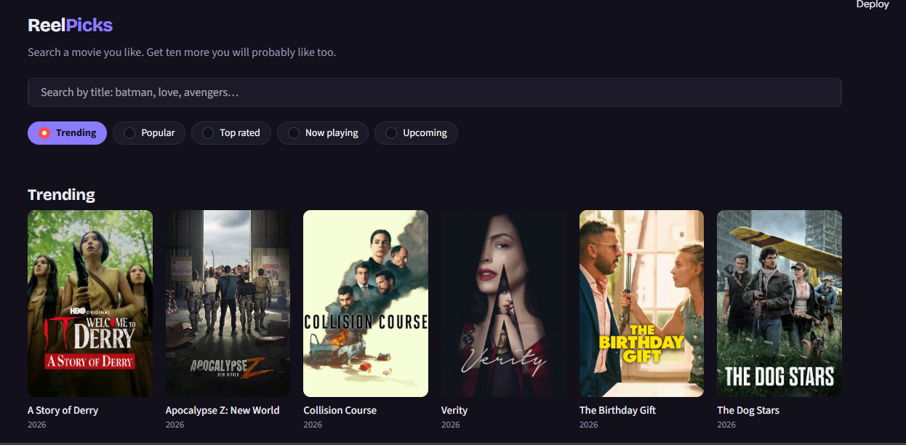
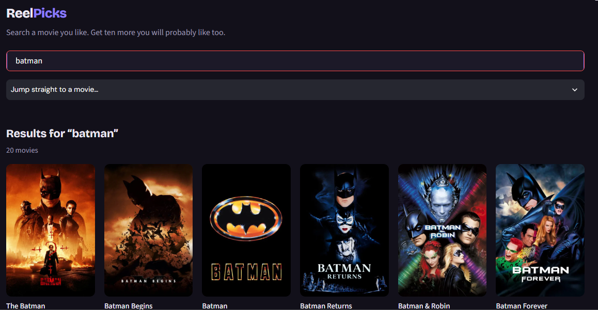

# Movie Recommendation System

A movie recommendation web application that helps users discover movies through search and personalized recommendations. The application combines content-based filtering with the TMDB API to provide movie information, posters, ratings, and recommendations.

## Features

* Search for movies by title.
* Get movie recommendations using content-based filtering.
* Explore movies by genre.
* View movie details, ratings, release dates, and posters.
* Retrieve movie information using the TMDB API.
* Interactive web interface built with Streamlit.

## Technologies Used

* **Python** – Core programming language
* **Pandas & NumPy** – Data processing
* **Scikit-learn** – TF-IDF vectorization
* **Cosine Similarity** – Movie similarity calculation
* **FastAPI** – Backend API
* **Streamlit** – Frontend interface
* **TMDB API** – Movie information and posters
* **Render** – Backend deployment

## Project Architecture

The project follows a frontend-backend architecture:

1. **Streamlit Frontend:** Provides the user interface for searching and exploring movies.
2. **FastAPI Backend:** Handles API requests and recommendation operations.
3. **Recommendation Engine:** Uses TF-IDF vectorization and cosine similarity to identify similar movies.
4. **TMDB API:** Retrieves movie details and poster information.

## Recommendation Method

The recommendation engine uses content-based filtering.

* Movie information is converted into numerical representations using TF-IDF.
* Cosine similarity measures the similarity between movie vectors.
* Movies with higher similarity scores are recommended to users.

## Project Structure

```text
movie-recommendation-system/
│
├── app.py
├── main.py
├── requirements.txt
├── README.md
├── .gitignore
│
├── df.pkl
├── indices.pkl
├── tfidf.pkl
└── tfidf_matrix.pkl
```

## Installation and Setup

### 1. Clone the repository

```bash
git clone https://github.com/AyeshaArif-10/movie_recommendation_system.git
```

### 2. Navigate to the project directory

```bash
cd movie-recommendation-system
```

### 3. Install dependencies

```bash
pip install -r requirements.txt
```

### 4. Run the Streamlit application

```bash
streamlit run app.py
```

## Deployment

The Streamlit frontend runs locally, while the FastAPI backend is deployed on Render.

## Future Improvements

* Improve recommendation quality using additional movie features.
* Add user-based personalized recommendations.
* Enhance the user interface.
* Explore advanced recommendation algorithms.

## Application Preview

### Home Page

The home page displays trending movies with posters, titles and release years.



### Movie Search

Users can search for movies by title and explore matching results.




## Author
Ayesha Arif
